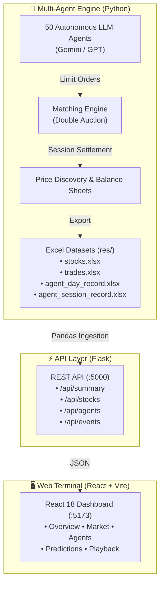

# StockAgent: When AI Meets Finance

[](https://www.python.org/)
[](https://react.dev/)
[](https://vitejs.dev/)
[](https://flask.palletsprojects.com/)
[](https://tailwindcss.com/)
[](https://ai.google.dev/)


Can AI Agents simulate real-world trading environments to investigate the impact of external factors on stock trading activities? Factors like macroeconomics, policy changes, company fundamentals, and global events frequently influence trading behaviors and are critical in maximizing investors' profits. 

**StockAgent** is a multi-agent AI system driven by Large Language Models (LLMs like Gemini and GPT) designed to simulate investors' trading behaviors in a realistic stock market. The system allows users to evaluate the impact of external factors on investor trading, analyze behavior, and study profitability effects. Crucially, StockAgent operates in a purely simulated environment, avoiding the "test set leakage" issue present in many AI trading systems (where models cheat by relying on memorized historical market data).

---

## 🌟 Key Highlights

- **Zero Data Leakage Environment**: Evaluates trading agents in an emergent, synthetic market without historical curve-fitting.
- **Continuous Double-Auction Order Book**: 3 intraday trading sessions per day (Opening Cross, Mid-Day Continuous, Closing Cross) with limit order execution.
- **Cognitive Consistency & Prediction Calibration**: Empirically audits stated forward guidance vs. realized next-day actions across 13,000+ data points.
- **Macroeconomic Policy Sensitivity**: Simulates central bank policy shifts (Day 78 Reserve Requirement Cut, Day 144 Interest Rate Hike) to study herd behavior and reflexivity.
- **Full-Stack Analytics Terminal**: React 18 + Recharts interactive dashboard providing real-time playback, liquidity heatmaps, multi-agent wealth tracking, and leaderboards.

---

## 🏗️ Architecture & Workflow


The simulation workflow consists of four core phases:
1. **Initial Phase**: Agents are initialized with starting cash, stock portfolios, debt obligations, and distinct trading personas (`Conservative`, `Aggressive`, `Balanced`, `Growth-Oriented`).
2. **Trading Phase**: Agents analyze market depth and execute buy/sell decisions across 3 daily trading sessions via a continuous double-auction matching engine.
3. **Post-Trading Phase**: Daily and quarterly events occur. Agents self-evaluate their portfolios, submit next-day action forecasts, and post sentiment to a public forum influencing future market cycles.
4. **Special Events Phase**: Macroeconomic shocks (interest rate hikes, reserve ratio cuts) are introduced to test agent risk management and behavioral reflexivity.



---

## 🖥️ The StockAgent Dashboard

The project includes an interactive web terminal built with **React 18, Tailwind CSS, and Recharts**, fed by a **Flask REST API**:

| View | Key Features |
|---|---|
| **📊 Overview (`/`)** | Executive KPI cards, dual-ticker price trajectory with central bank event callouts, intraday trade volume, leverage area charts, and live order telemetry. |
| **🔬 Market Analysis (`/market`)** | Bid/ask spread differential curve ($|B - A|$), session liquidity breakdown, order direction ratio (Buy vs Sell), and trade price clustering histogram. |
| **👥 Agent Explorer (`/agents`)** | Multi-agent wealth comparison overlays (up to 5 simultaneous traders), sortable leaderboard (Rank, ROI %, Wealth, Status), and deep-dive cards detailing asset allocation. |
| **🧠 Predictions (`/predictions`)** | Grouped calibration matrix (Intent vs Execution across 5 actions), longitudinal prediction accuracy vs a 50% random baseline, and paginated audit logs. |
| **🎬 Simulation Playback (`/playback`)** | Interactive time-lapse scrubber (Days 1–264), play/pause controls, dynamic price reveals, event banners, and real-time market sentiment meter. |

---

## ⚡ Quick Start (Instant Demo Mode)

Explore the pre-simulated 264-day dataset instantly without needing an LLM API key.

### Option 1: One-Click Launch (Windows)
Double-click `start.bat` in the repository root. This automatically spins up:
- **Flask REST API** at `http://localhost:5000`
- **React Dashboard** at `http://localhost:5173`

### Option 2: Manual Terminal Launch

**1. Launch API Backend:**
```powershell
pip install -r api/requirements.txt
cd api
python app.py
```

**2. Launch Frontend:**
```powershell
cd dashboard
npm install
npm run dev
```
Open **`http://localhost:5173`** in your browser.

---

## 🛠️ Complete Setup Guide (Running Live LLM Simulations)

To run active multi-agent simulations with live LLM queries, you will need **Python (3.9+)** and **Node.js (18+)**.

### 1. Create and Activate a Virtual Environment
It is highly recommended to use a virtual environment so the project dependencies don't conflict with your system Python:

```powershell
# Create the virtual environment named "stockagent_env"
python -m venv stockagent_env

# Activate the virtual environment
.\stockagent_env\Scripts\activate
```
*(You should see `(stockagent_env)` appear at the beginning of your command prompt).*

### 2. Install PromptCoder (Required Dependency)
This project relies on an external prompt engineering tool called `PromptCoder`. You need to clone and install it into your environment:

```powershell
# Clone PromptCoder
git clone https://github.com/dhh1995/PromptCoder
cd PromptCoder

# Install it into the active virtual environment
pip install -e .

# Return to project root
cd ..
```

### 3. Install Project Dependencies
Install the required packages using the `requirements.txt` files:

```powershell
# Simulation dependencies
pip install -r requirements.txt

# Dashboard API dependencies
pip install -r api/requirements.txt

# Dashboard frontend dependencies
cd dashboard
npm install
cd ..
```

---

## 🚀 Running the Simulation

Before running the simulation, configure the API key for your chosen LLM as an environment variable:

### API Key Configuration
For **Google Gemini** (Recommended):
```powershell
# Windows PowerShell
$env:GOOGLE_API_KEY="YOUR_GEMINI_API_KEY"

# Linux / macOS
export GOOGLE_API_KEY="YOUR_GEMINI_API_KEY"
```

For **OpenAI (GPT)**:
```powershell
# Windows PowerShell
$env:OPENAI_API_KEY="YOUR_OPENAI_API_KEY"

# Linux / macOS
export OPENAI_API_KEY="YOUR_OPENAI_API_KEY"
```

### Start the Simulation
Run `main.py` specifying the model:

```powershell
python main.py --model gemini-3.8-flash
```

*Note: Older model identifiers like `gemini-pro` and `gemini-2.5-pro` are deprecated and may return 404. It is recommended to use `gemini-3.8-flash`.*

When the simulation completes a trading day, all agent behaviors, portfolios, and decisions will be exported into Excel files in the `res/` directory and immediately reflected on the dashboard upon refresh.

---

## 📁 Repository Structure

```text
Stock_Market_Simulation/
├── api/                        # Flask REST API backend
│   ├── app.py                  # API endpoints and CORS configuration
│   ├── data_loader.py          # Excel dataset parsing and KPI aggregations
│   └── requirements.txt        # Backend Python dependencies
├── dashboard/                  # React 18 frontend
│   ├── src/
│   │   ├── components/         # Layout, Sidebar, StatCards
│   │   ├── pages/              # Overview, Market, Agents, Predictions, Playback
│   │   ├── hooks/              # useApi data fetcher
│   │   └── utils/              # Formatting & constants
│   ├── vite.config.js          # Vite config & proxy rules
│   └── package.json            # Frontend dependencies
├── fig/                        # Architecture & schematic diagrams
│   ├── architecture.png
│   ├── schematic.png
│   ├── workflow.png
│   └── workflow2.png
├── prompt/                     # Agent behavioral prompts (English)
│   └── agent_prompt.py
├── res/                        # Simulation Excel outputs (264-day dataset)
│   ├── stocks.xlsx
│   ├── trades.xlsx
│   ├── agent_day_record.xlsx
│   └── agent_session_record.xlsx
├── agent.py                    # Autonomous Agent class & balance sheet logic
├── main.py                     # Main simulation loop & matching engine
├── record.py                   # Excel export schemas
├── secretary.py                # LLM JSON validator & retry handler
├── stock.py                    # Stock price tracking & corporate earnings
├── util.py                     # Simulation constants, macro shocks & rate tables
├── generate_mock_results.py    # Synthetic dataset generator
└── start.bat                   # One-click dashboard launcher
```

---

## 📄 License
This project is released under the [MIT License](LICENSE).
