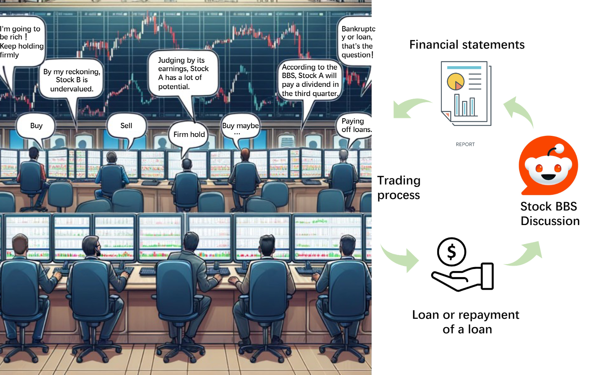

# StockAgent: When AI Meets Finance



Can AI Agents simulate real-world trading environments to investigate the impact of external factors on stock trading activities? Factors like macroeconomics, policy changes, company fundamentals, and global events frequently influence trading behaviors and are critical in maximizing investors' profits. 

**StockAgent** is a multi-agent AI system driven by Large Language Models (LLMs like Gemini and GPT) designed to simulate investors' trading behaviors in a realistic stock market. The system allows users to evaluate the impact of external factors on investor trading, analyze behavior, and study profitability effects. Crucially, StockAgent operates in a purely simulated environment, avoiding the "test set leakage" issue present in many AI trading systems (where models cheat by relying on memorized historical market data).


## Architecture


The workflow consists of four main phases:
1. **Initial Phase**: Agents are initialized with starting cash, stock portfolios, and debts.
2. **Trading Phase**: Agents analyze market data and make buy/sell decisions across multiple trading sessions per day.
3. **Post-Trading Phase**: Daily and Quarterly events occur. Agents post their thoughts and sentiments to a shared forum that influences future decisions.
4. **Special Events Phase**: Random events (like interest rate shifts) are introduced to test agent adaptability.

---

## 🛠️ Complete Setup Guide (Windows / PowerShell)

To run StockAgent on your local machine, you will need **Python (3.9 or higher)** installed. The following instructions walk you through setting up a virtual environment and installing all required dependencies.

### 1. Create and Activate a Virtual Environment
It is highly recommended to use a virtual environment so the project dependencies don't conflict with your system Python. Open your PowerShell terminal in the project directory and run:

```powershell
# Create the virtual environment named "stockagent_env"
python -m venv stockagent_env

# Activate the virtual environment
.\stockagent_env\Scripts\activate
```
*(You should see `(stockagent_env)` appear at the beginning of your command prompt).*

### 2. Install PromptCoder (Required Dependency)
This project relies on an external prompt engineering tool called `PromptCoder`. You need to clone and install it into your environment:

```powershell
# Go back to the parent directory
cd ..

# Clone PromptCoder
git clone https://github.com/dhh1995/PromptCoder
cd PromptCoder

# Install it into the active virtual environment
..\stockagent_env\Scripts\pip.exe install -e .

# Return to the StockAgent folder
cd ..\Stock_agent
```

### 3. Install Project Dependencies
Install the required packages (like `pandas`, `openai`, `openpyxl`, and `google-generativeai`) using the `requirements.txt` file:

```powershell
pip install -r requirements.txt
```

---

## 🚀 Running the Simulation

Before running the simulation, you **must** configure the API key for your chosen LLM. 

### API Key Configuration
For **Google Gemini** (Default):
```powershell
$env:GOOGLE_API_KEY="YOUR_GEMINI_API_KEY"
```

For **OpenAI (GPT)**:
```powershell
$env:OPENAI_API_KEY="YOUR_OPENAI_API_KEY"
```

### Start the Simulation
You can start the simulation by running `main.py` and specifying the model you wish to use. 

*Note: Due to recent deprecations on Google's API, older model names like `gemini-pro` may return a 404 error. It is recommended to use modern models like `gemini-2.5-pro` or `gemini-pro-latest`.*

```powershell
python main.py --model gemini-2.5-pro
```

When the simulation completes a trading day, all agent behaviors, portfolios, and decisions will be exported into an Excel file using the `openpyxl` engine.


